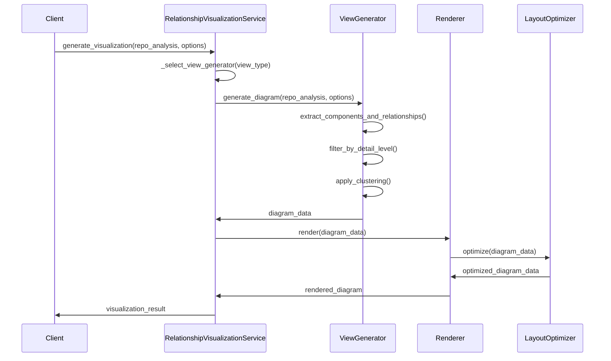

# Relationship Visualization System Design

## 1. Overview

The Relationship Visualization system generates architectural and component relationship diagrams using the UML 4+1 View Model. It focuses on creating clear, readable diagrams that accurately represent the complex relationships in a codebase while maintaining appropriate levels of detail and abstraction.

## 2. Core Principles

- **Multiple View Support**: Generate visualizations for all 4+1 architectural views
- **Detail Management**: Provide appropriate levels of detail based on the scope and complexity
- **Clarity First**: Prioritize readability over completeness for complex systems
- **Consistent Styling**: Maintain visual consistency across all diagram types
- **Intelligent Clustering**: Group related components to reduce visual complexity
- **Customization Options**: Allow customization of diagram generation parameters

## 3. System Architecture

The Relationship Visualization system follows SOLID principles with a modular, extensible design.

```mermaid
classDiagram
    class RelationshipVisualizationService {
        <<service>>
        +generate_visualization(repo_analysis, options)
        +generate_all_views(repo_analysis, options)
        -_select_view_generator(view_type)
    }

    class VisualizationOptions {
        +detail_level: str
        +cluster_threshold: int
        +include_metrics: bool
        +max_components: int
        +focus_components: List[str]
        +output_format: str
        +styling: Dict
    }

    class ViewGenerator {
        <<interface>>
        +generate_diagram(repo_analysis, options)
        +get_supported_diagrams()
    }

    class LogicalViewVisualizer {
        +generate_diagram(repo_analysis, options)
        +generate_class_diagram()
        +generate_object_diagram()
        +generate_state_diagram()
        -_apply_clustering()
    }

    class ProcessViewVisualizer {
        +generate_diagram(repo_analysis, options)
        +generate_sequence_diagram()
        +generate_activity_diagram()
        -_trace_interaction()
    }

    class DevelopmentViewVisualizer {
        +generate_diagram(repo_analysis, options)
        +generate_package_diagram()
        +generate_component_diagram()
        -_analyze_dependencies()
    }

    class PhysicalViewVisualizer {
        +generate_diagram(repo_analysis, options)
        +generate_deployment_diagram()
        +generate_infrastructure_diagram()
        -_map_physical_components()
    }

    class ScenariosViewVisualizer {
        +generate_diagram(repo_analysis, options)
        +generate_use_case_diagram()
        +generate_user_flow_diagram()
        -_extract_scenarios()
    }

    class DiagramRenderer {
        <<interface>>
        +render(diagram_data)
    }

    class MermaidRenderer {
        +render(diagram_data)
        -_format_diagram()
        -_optimize_layout()
    }

    class PlantUMLRenderer {
        +render(diagram_data)
        -_format_diagram()
        -_optimize_layout()
    }

    class LayoutOptimizer {
        +optimize(diagram_data)
        +reduce_crossing_lines()
        +balance_node_distribution()
        +adjust_element_spacing()
    }

    RelationshipVisualizationService o-- ViewGenerator : uses
    RelationshipVisualizationService o-- DiagramRenderer : uses
    RelationshipVisualizationService -- VisualizationOptions : configures

    ViewGenerator <|.. LogicalViewVisualizer : implements
    ViewGenerator <|.. ProcessViewVisualizer : implements
    ViewGenerator <|.. DevelopmentViewVisualizer : implements
    ViewGenerator <|.. PhysicalViewVisualizer : implements
    ViewGenerator <|.. ScenariosViewVisualizer : implements

    DiagramRenderer <|.. MermaidRenderer : implements
    DiagramRenderer <|.. PlantUMLRenderer : implements

    DiagramRenderer o-- LayoutOptimizer : uses
```

## 4. SOLID Principles Implementation

### 4.1 Single Responsibility Principle
- Each view generator focuses only on diagrams for a specific architectural view
- Diagram rendering is separated from diagram data generation
- Layout optimization is isolated to a specific component

### 4.2 Open/Closed Principle
- The system is open for extension (new visualizers can be added) but closed for modification
- The rendering interface allows multiple rendering engines without modifying existing code

### 4.3 Liskov Substitution Principle
- All view generators follow the same interface and can be used interchangeably
- All renderers follow the same interface and can be substituted without affecting the system

### 4.4 Interface Segregation Principle
- View generators expose only methods relevant to their specific view
- Renderers have a focused set of methods for diagram rendering

### 4.5 Dependency Inversion Principle
- High-level modules depend on abstractions (interfaces) not concrete implementations
- Configuration is injected rather than hardcoded

## 5. Visualization Process

1. **Analysis**: Parse the repository analysis data to extract relationships
2. **Selection**: Select appropriate visualization type based on view and context
3. **Filtering**: Filter components and relationships based on detail level and focus
4. **Clustering**: Group related components to reduce visual complexity
5. **Layout**: Optimize layout for readability and aesthetics
6. **Rendering**: Generate the final diagram in the requested format (Mermaid/PlantUML)

## 6. Detail Management Strategy

The system handles varying levels of detail through several strategies:

1. **Detail Levels**:
   - High: All components and relationships
   - Medium: Important components and direct relationships
   - Low: Core components and critical relationships only

2. **Clustering Algorithms**:
   - Hierarchical clustering based on package/module structure
   - Semantic clustering based on component names and purposes
   - Relationship-based clustering for highly interconnected components

3. **Visual Techniques**:
   - Component expansion/collapse capabilities
   - Focused views on specific subsystems
   - Highlighting of critical paths and relationships

## 7. Rendering and Styling

The system supports two primary rendering formats:

1. **Mermaid**:
   - Support for all diagram types
   - Browser-friendly rendering
   - GitHub-compatible syntax
   - Simpler syntax with built-in layout optimization

2. **PlantUML**:
   - More powerful styling options
   - Advanced layout capabilities
   - Better for complex diagrams
   - More customization options

Common styling elements across all diagrams:

- Consistent color scheme for component types
- Standardized relationship line styles
- Clear labels and descriptions
- Proper spacing and layout
- Visual highlighting of important elements

## 8. Integration with Existing Systems

The Relationship Visualization system integrates with:

1. **Repository Scanner**: Uses repository analysis data as input
2. **Code Analyzer**: Leverages detailed code structure information
3. **Framework Detector**: Incorporates framework-specific components
4. **AI Relationship Analyzer**: Uses AI-detected relationships
5. **Component Grouping**: Leverages logical component groupings
6. **Documentation System**: Integrates visualizations into documentation

## 9. Implementation Plan

1. **Phase 1 - Core Infrastructure**:
   - Implement base visualization service
   - Create view generator interfaces
   - Implement renderer interfaces
   - Develop basic layout optimization

2. **Phase 2 - View Implementations**:
   - Implement Logical View visualizer
   - Implement Process View visualizer
   - Implement Development View visualizer
   - Implement basic clustering algorithms

3. **Phase 3 - Advanced Features**:
   - Implement Physical View visualizer
   - Implement Scenarios View visualizer
   - Enhance clustering algorithms
   - Optimize layout strategies

4. **Phase 4 - Integration and Documentation**:
   - Integrate with existing documentation system
   - Generate samples for all view types
   - Add comprehensive documentation
   - Optimize styling and visual appearance

## 10. Testing Strategy

1. **Unit Testing**:
   - Test each visualizer independently
   - Verify renderer output against expected diagrams
   - Test layout optimization algorithms
   - Validate clustering strategies

2. **Integration Testing**:
   - Test integration with repository analysis
   - Verify integration with existing documentation system
   - Test performance with large codebases
   - Validate diagram quality and readability

3. **Visual Testing**:
   - Ensure diagram readability and clarity
   - Validate consistency across different diagram types
   - Verify proper handling of complex relationships
   - Test different detail levels and options